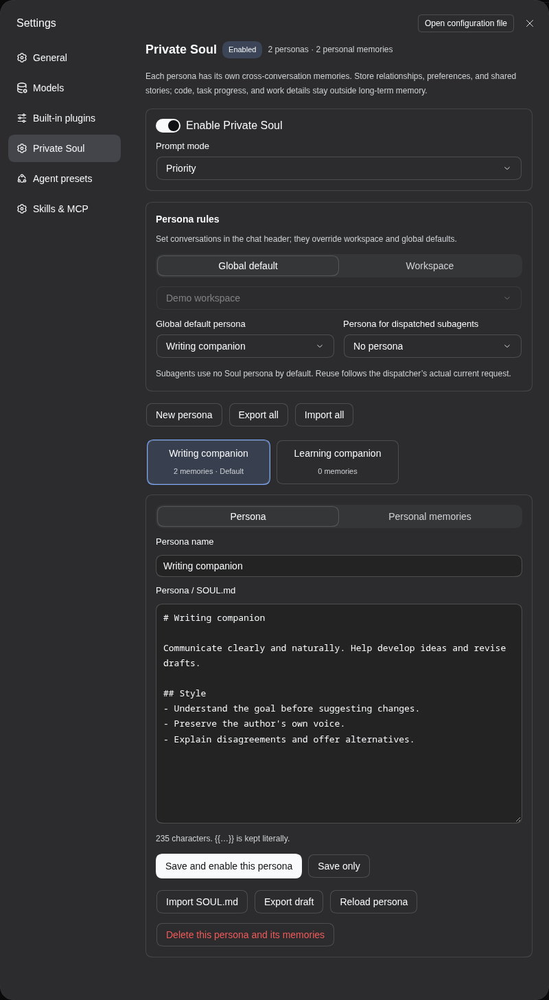

# DSH Soul Desk

[简体中文](https://github.com/ousiqwq/dsh-soul-desk/blob/main/README.md) | **English**

A persona and personal-memory manager for DeepSeek Harness. Choose a persona for each conversation and maintain separate memories across sessions for each persona.

Open **Settings → Private Soul**. Package: `dsh-plugin-private-soul`.

The interface uses DSH native i18n and follows language changes immediately. Chinese and English dictionaries are included; other interface languages use the native English fallback.

## Install the local build

Local build `0.5.3-local.2` targets DSH Web `0.2.3-alpha.2` and Node.js 26. Run on the profile host and supply the local tarball path.

```bash
dsh plugin --profile web add file:/absolute/path/dsh-plugin-private-soul-0.5.3-local.2.tgz
```

Standard and PTC use native instruction sources for personas, memories and optional enhancements. Presets with exclusive instructions retain the complete host prompt.

## Features

- **Three-level rules:** global → workspace → conversation. Explicit conversation choices take priority; “No persona” stops inheritance.
- **Subagent policies:** no Soul persona by default; inherit the dispatcher's persona or choose another at the same three levels. One native dropdown controls both selections.
- **Separate memories:** manage relationships, preferences, and shared stories with search, editing, deduplication, and consolidation previews.
- **Three prompt modes:** prioritize, replace, or append the persona while retaining native tools and runtime context.
- **Import and export:** persona Markdown, full JSON archives, and merge imports.
- **Automatic memory:** use the current conversation's model or the default model to review memories and suggest consolidation.
- **Persistent settings:** revision-conflict checks, recovery backups, light/dark themes, and responsive layouts.

### Persona management

Create and edit personas, choose a prompt mode, and select the default. Each conversation can use a specific persona, follow the default, or turn personas off.

Screenshots show the current native DSH UI with isolated sample data; settings are expanded for readability.



### Personal memories

Filter and search by category, add or edit memories, and preview consolidation before applying it.


## Usage

1. Select **New persona** and enter a name and persona text.
2. **Save only** saves your changes. **Save and enable this persona** also sets the persona as the global default.
3. Use the conversation's persona menu to select a persona, **Follow default**, or **No persona for this conversation**.
4. Open **Personal memories** to manage that persona's relationships, preferences, and stories.

Use **Persona rules** to configure global and workspace defaults. Edit conversation choices only in the chat header dropdown, whose conversation and subagent groups control the two selections independently. Conversation overrides take priority. The collapsed workspace picker displays only the name; expanded options show paths as smaller, muted notes. Requests already sent retain their persona and memory ownership.

| Scope | Own persona | Dispatched subagents |
| --- | --- | --- |
| Global | Specific persona / None | None (initial default) / Reuse current / Specific persona |
| Workspace | Follow global / Specific / None | Follow global / None / Reuse current / Specific |
| Conversation | Follow workspace / Specific / None | Follow default / None / Reuse current / Specific |

Native subagents capture their selection when created. Later changes to the parent do not rewrite existing children; each child can also choose independently. Missing, deleted, or empty personas stop injection rather than silently selecting another. Independent outer Team Desk members use ordinary conversation rules.

Disabled children receive no new Soul persona, private memories, or memory instructions, and memory tools refuse access. **Native fork copies parent history**: disabling subsequent injection does not erase private information already in that history. Use fresh spawn when parent history must not be copied. External ACP backends are not covered by persona control.

| Prompt mode | Behavior |
| --- | --- |
| Priority | Place persona text before the system prompt's tool and framework guidance |
| Replace | Replace editable identity sections and retain native task instructions and tools |
| Append | Preserve the original system prompt and append the persona and personal memories at the end |

The interface uses short labels; hover over a mode to see its explanation.

Persona text is literal: `{{...}}` is not interpolated. The global switch controls persona injection and automatic memory tools; disabling it retains saved content.

Team Desk 0.14.0 can select a persona for each preset member and its future subagents. Explicit selections take precedence when applied; unspecified fields keep the existing Soul rules. Members remain editable afterward in either conversation menus or Team Desk. The global switch remains authoritative. See the [team integration contract](docs/TEAM-BRIDGE.md).

## Response enhancement and preset adaptation

Upgrade preserves the enhancement toggle, individual preferences, personas, memories, and session and workspace bindings. A version 1 body that is still the previously bundled text is upgraded to the current bundled text; a body you authored or emptied stays empty. Text can be edited in advanced settings. Reading a version 1 configuration migrates it in memory; the next edit writes version 2.

The enhancement uses native system instruction sources. Diagnostics build a fresh preset preview, with an explicit opt-in for custom presets. Presets with an exclusive system prompt keep the host’s complete text. Optional subagent guidance has its own switch. See [Response enhancement](docs/RESPONSE-ENHANCEMENT.zh-CN.md).

## Try the Ronova preset

An optional **Ronova** persona preset is included and can be imported after installation.

1. Download [ronova.json](https://github.com/ousiqwq/dsh-soul-desk/releases/download/v0.3.1/ronova.json).
2. In settings, choose **Import all** and select the merge option.
3. Review the persona, save and enable it, or select Ronova in a specific conversation.

Alternatively, load [ronova.SOUL.md](https://github.com/ousiqwq/dsh-soul-desk/blob/main/presets/ronova.SOUL.md) into the editor using **Import SOUL.md**.

## Memories and storage

Memory categories are `relationship`, `preference`, and `story`. Models can manage the current persona's memories through `soul_memory_read`, `soul_memory_remember`, `soul_memory_update`, `soul_memory_forget`, and `soul_memory_consolidate`.

Automatic writes pass content filtering and model review. Consolidation produces a preview for confirmation. Each persona supports up to 500 memories, each up to 1,600 characters; a full archive can be up to 8 MiB.

Data is stored in `$DSH_HOME/private-soul/`, or `~/.dsh/private-soul/` by default. `library.json` holds personas, memories, three-level rules, and captured child selections. `backups/` holds recovery archives created before deletion, consolidation, or full imports. Uninstalling retains the data.

0.4.0 migrates v2 to v3 automatically, preserving the exact original file as `library.json.pre-v3.json` before the first migration. Existing personas, memories, and explicit conversation bindings are retained. Old subagents without an explicit choice use the new “None” default. Exports use v3; v2 imports remain supported. Rolling back requires restoring both the old plugin and its pre-migration data; old plugins cannot read v3.

## Development

```bash
npm ci --ignore-scripts
npm run check
npm test
npm pack --ignore-scripts
```

See [TESTING.md](https://github.com/ousiqwq/dsh-soul-desk/blob/main/docs/TESTING.md) for development commands.

## License

[MIT](https://github.com/ousiqwq/dsh-soul-desk/blob/main/LICENSE) © 2026 osiqwq

## Project acknowledgment

See the [third-party notices](THIRD_PARTY_NOTICES.md) for historical licensing.

## Subagent enhancement

Enable **Subagent enhancement** under **Response enhancement → Advanced settings → General**. The guidance helps the model recognize independent work, such as reconciling figures while drafting a guide. The task and available native tools determine whether a child is useful. Results return to the originating session for review and integration. This option defaults to off and takes effect when response enhancement is enabled.
