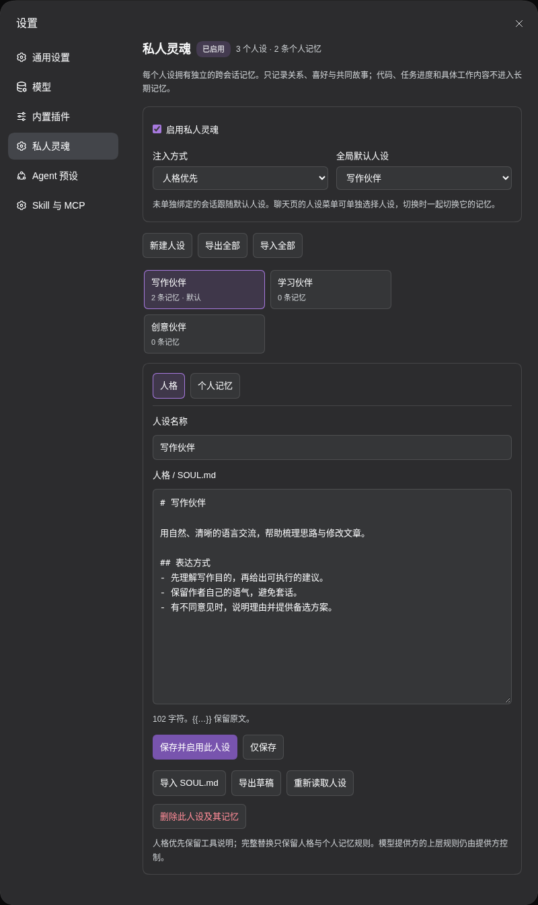
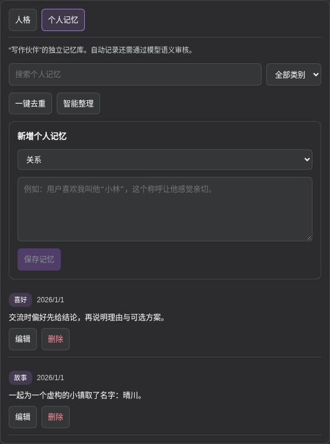

# DSH Soul Desk

[简体中文](README.md) | **English**

A persona and personal-memory manager for DeepSeek Harness. Choose a persona for each conversation and maintain separate memories across sessions for each persona.

Open **Settings → 私人灵魂 (Private Soul)**. Package: `dsh-plugin-private-soul`.

## Features

- **Multiple personas:** edit full persona instructions, set a global default, and switch per conversation.
- **Separate memories:** manage relationships, preferences, and shared stories with search, editing, deduplication, and consolidation previews.
- **Two prompt modes:** prioritize the persona or replace the system prompt body while retaining native tools and runtime context.
- **Import and export:** persona Markdown, full JSON archives, and merge imports.
- **Automatic memory:** use the current conversation's model or the default model to review memories and suggest consolidation.
- **Persistent settings:** revision-conflict checks, recovery backups, light/dark themes, and responsive layouts.

### Persona management

Create and edit personas, choose a prompt mode, and select the default. Each conversation can use a specific persona, follow the default, or turn personas off.



### Personal memories

Filter and search by category, add or edit memories, and preview consolidation before applying it.



## Installation

Compatible with DeepSeek Harness **0.2.1-rc.3 / 0.2.1-rc.5** and Node.js **26**. Check interface compatibility before using another Harness version.

```bash
dsh plugin --profile web add https://github.com/ousiqwq/dsh-soul-desk/releases/download/v0.2.4/dsh-plugin-private-soul-0.2.4.tgz
```

Enable the plugin in DSH's plugin manager, restart DSH, refresh the page, and open **Settings → 私人灵魂**. Packages are also available from [Releases](https://github.com/ousiqwq/dsh-soul-desk/releases).

## Usage

1. Select **新建人设 (New persona)** and enter a name and persona text.
2. **仅保存 (Save)** saves your changes. **保存并启用此人设 (Save and enable)** also sets the persona as the global default.
3. Use the conversation's persona menu to select a persona, **跟随默认 (Follow default)**, or **此会话不使用人设 (No persona for this session)**.
4. Open **个人记忆 (Personal memories)** to manage that persona's relationships, preferences, and stories.

Subagents inherit their owning conversation's selection. Requests already sent retain the persona selected when they were sent. Switching personas also switches the associated memories.

| Prompt mode | Behavior |
| --- | --- |
| Persona priority | Place persona text before the system prompt's tool and framework guidance |
| Complete replacement | Replace the system prompt body with persona text while retaining tool schemas and runtime context |

Persona text is literal: `{{...}}` is not interpolated. The global switch controls persona injection and automatic memory tools; disabling it retains saved content.

## Try the Ronova preset

An optional **Ronova** persona preset is included and can be imported after installation.

1. Download [ronova.json](https://github.com/ousiqwq/dsh-soul-desk/releases/download/v0.2.4/ronova.json).
2. Choose **导入全部 → 合并导入 (Import all → Merge)** in settings.
3. Review the persona, save and enable it, or select Ronova in a specific conversation.

Alternatively, load [ronova.SOUL.md](presets/ronova.SOUL.md) into the editor using **导入 SOUL.md (Import SOUL.md)**.

## Memories and storage

Memory categories are `relationship`, `preference`, and `story`. Models can manage the current persona's memories through `soul_memory_read`, `soul_memory_remember`, `soul_memory_update`, `soul_memory_forget`, and `soul_memory_consolidate`.

Automatic writes pass content filtering and model review. Consolidation produces a preview for confirmation. Each persona supports up to 500 memories, each up to 1,600 characters; a full archive can be up to 8 MiB.

Data is stored in `$DSH_HOME/private-soul/`, or `~/.dsh/private-soul/` by default. `library.json` holds personas, memories, and session bindings. `backups/` holds recovery archives created before deletion, consolidation, or full imports. Uninstalling retains the data.

## Development

```bash
npm ci --ignore-scripts
npm run check
npm test
npm pack --ignore-scripts
```

See [TESTING.md](docs/TESTING.md) for development checks.

## License

[MIT](LICENSE) © 2026 osiqwq
