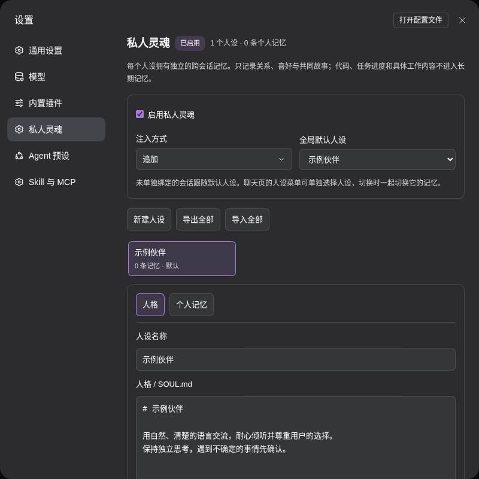
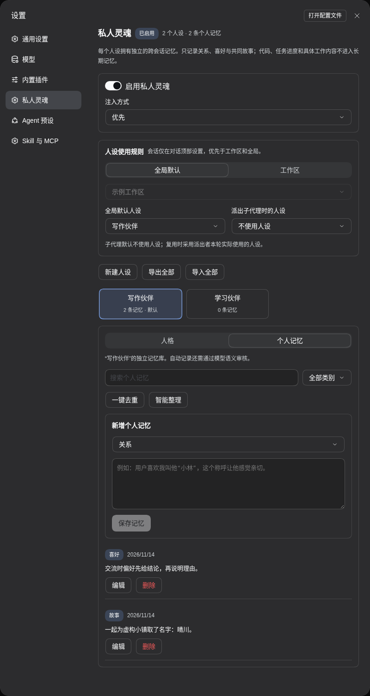

# DSH Soul Desk

**简体中文** | [English](https://github.com/ousiqwq/dsh-soul-desk/blob/main/README.en.md)

DeepSeek Harness 的人格与个人记忆管理插件。为不同对话选择合适的人设，并为每个人设维护独立的跨会话记忆。

入口：**设置 → 私人灵魂** · 插件包：`dsh-plugin-private-soul`

界面接入 DSH 原生 i18n，实时跟随 DSH 的语言设置。内置中英文词典；其他界面语言按 DSH 的规则回退到英文。

## 一键安装

兼容 DeepSeek Harness **0.2.1-rc.3 / 0.2.1-rc.5 / 0.2.2-rc.2**，Node.js **26**。

```bash
dsh plugin --profile web add dsh-plugin-private-soul
```

在 DSH 插件管理中启用插件，重启 DSH 并刷新页面，然后打开 **设置 → 私人灵魂**。

## 功能

- **三层人设规则**：全局 → 工作区 → 会话，会话菜单中的明确选择优先；选择“不使用”即停止继承。
- **子代理策略**：默认不使用 Soul 人设，可按同样三层规则选择复用派出者或指定人设；一个原生下拉同时管理本会话与子代理。
- **独立记忆**：按人设管理关系、喜好与共同故事，支持查询、编辑、去重和整理预览。
- **三种提示词模式**：选择优先、替换或追加，配合原生工具与运行上下文使用。
- **导入与导出**：支持人格 Markdown、整体 JSON，以及合并导入。
- **自动记忆**：使用当前会话或默认模型审核记忆、生成整理建议。
- **持久保存**：支持修订冲突检查、恢复备份、深浅主题与窄屏布局。

### 人设管理

新建或编辑人设，选择注入方式和默认人设。聊天页可独立选择具体人设、跟随默认或停用。



### 个人记忆

按类别筛选和搜索记忆，手动补充内容，或先查看智能整理建议再应用。



## 使用

1. 点击 **新建人设**，填写名称与人格文本。
2. **仅保存** 保存当前编辑；**保存并启用此人设** 同时设为全局默认。
3. 在聊天页的人设菜单中，为当前会话选择具体人设、**跟随默认** 或 **此会话不使用人设**。
4. 进入 **个人记忆**，管理该人设的关系、喜好和故事。

在 **人设使用规则** 中切换全局、工作区、会话范围。聊天页下拉中的“本会话”和“子代理”分别控制自身选择及派出策略，和设置页保存到同一份记录。已发送请求保留本轮的人设与记忆归属。

| 范围 | 自身人设 | 派出子代理 |
| --- | --- | --- |
| 全局 | 指定人设 / 不使用 | 不使用（初始默认） / 复用当前 / 指定人设 |
| 工作区 | 跟随全局 / 指定 / 不使用 | 跟随全局 / 不使用 / 复用当前 / 指定 |
| 会话 | 跟随工作区 / 指定 / 不使用 | 跟随默认 / 不使用 / 复用当前 / 指定 |

原生子代理创建时保存派生决定；父会话之后切换不会改写已有子代理。子代理也能单独选择人设。未配置的人设、空内容或已删除的人设停止注入，不会偷偷改用另一人设。Team Desk 的外层独立成员仍按普通会话规则处理。

默认关闭的子代理不新增 Soul 人设、私人记忆或记忆指令，记忆工具也拒绝访问。**原生 fork 会复制父会话的历史**，关闭后续注入不会清除历史中已有的私人信息；需要不带父历史时请用 fresh spawn。外部 ACP 后端的人设控制未验证。

| 注入方式 | 行为 |
| --- | --- |
| 优先 | 将人格文本放在系统提示词前部，保留工具和框架说明 |
| 替换 | 使用人格文本替换系统提示词正文，保留工具 schema 与运行时上下文 |
| 追加 | 保留原有系统提示词，在末尾追加人格与个人记忆 |

界面使用简短名称，鼠标悬停选项查看说明。

人格文本按字面处理，`{{...}}` 不作模板插值。全局开关控制人格注入和自动记忆工具，关闭后保留已有内容。

## 尝试若娜瓦预设

内置可选的 **若娜瓦** 角色预设，安装后可手动导入体验。

1. 下载 [ronova.json](https://github.com/ousiqwq/dsh-soul-desk/releases/download/v0.3.1/ronova.json)。
2. 在设置中选择 **导入全部 → 合并导入**。
3. 查看设定，保存并启用，或在目标会话中选择若娜瓦。

也可以下载 [ronova.SOUL.md](https://github.com/ousiqwq/dsh-soul-desk/blob/main/presets/ronova.SOUL.md)，通过 **导入 SOUL.md** 载入编辑器。

## 记忆与存储

记忆分为 `relationship`（关系）、`preference`（喜好）和 `story`（共同故事）。模型可通过 `soul_memory_read`、`soul_memory_remember`、`soul_memory_update`、`soul_memory_forget`、`soul_memory_consolidate` 管理当前人设的记忆。

自动写入经过内容过滤和模型审核；智能整理先生成预览，确认后保存。每个人设最多 500 条记忆，每条最多 1600 字符，整体存档最多 8 MiB。

运行数据位于 `$DSH_HOME/private-soul/`，默认 `~/.dsh/private-soul/`。`library.json` 保存人设、记忆、三层规则与子代理派生决定，`backups/` 保存删除、整理或整体导入前的恢复存档。卸载插件保留数据。

0.4.0 自动迁移 v2 到 v3，并在首次迁移前将原文件原样保存为 `library.json.pre-v3.json`。原有人设、记忆和明确会话绑定保留；旧子代理没有明确选择时采用“不使用”的新默认。导出为 v3，仍可导入 v2。回滚旧插件时必须同时恢复迁移前数据；不要用旧插件读取 v3 文件。

## 开发

```bash
npm ci --ignore-scripts
npm run check
npm test
npm pack --ignore-scripts
```

开发命令见 [TESTING.md](https://github.com/ousiqwq/dsh-soul-desk/blob/main/docs/TESTING.md)。

## 许可证

[MIT](https://github.com/ousiqwq/dsh-soul-desk/blob/main/LICENSE) © 2026 osiqwq
